<picture>
  <source media="(prefers-color-scheme: dark)" srcset="./assets/hero-dark.svg">
  
</picture>

  
  
  
  
  
  

## About

I'm a full-stack and Web3 engineer studying at IIT Roorkee, more at home in a codebase than a foundry.

I build things end to end: realtime apps backed by CRDTs, on-chain protocols in Solidity, and tools that put language models to work on real problems. A lot of it started at hackathons, including a few ETHGlobal builds and an ENS partner prize at HackMoney.

## Now

I'm building plugins and connectors for Claude, starting with [product-ad-video](https://github.com/Dhananjay-alt/product-ad-video-skill). Alongside that I'm trying to contribute more to open source and spending the rest of my time on AI projects.

## Selected work

[**product-ad-video**](https://github.com/Dhananjay-alt/product-ad-video-skill) 
A Claude Code plugin that makes a product launch video from a repo, entirely in code. Blender for the 3D, Remotion for the motion graphics.

[**TEM-AI**](https://github.com/Dhananjay-alt/TEM-AI-assistant) · [live](https://tem-ai-assistant.vercel.app) 
Answers questions about transmission electron microscopy. It looks the topic up in Williams and Carter first, so every claim points back to a page you can check.

[**Hexera**](https://github.com/Dhananjay-alt/Hexera) 
x402 payments on Hedera that can't be traced back to the payer. Blind-signed vouchers, a public topic as the double-spend registry, and no smart contracts.

[**AnonScope**](https://github.com/Dhananjay-alt/AnonScope) 
Measures whether Anon-RPC networks actually hide a wallet from its RPC provider. Built at ETHGlobal Mumbai, November 2026.

[**SyncSpace**](https://github.com/Dhananjay-alt/syncspace) · [live](https://syncspace-weld.vercel.app) 
Study rooms with shared notes, a shared editor, and Python that runs in a throwaway Docker container. Built solo in five days for MDG Space's Nebula competition.

[**Paygent v2**](https://github.com/Dhananjay-alt/paygent-v2) 
Subscriptions on-chain. The payment rules live in ENS records, and Chainlink Automation runs them without an off-chain scheduler.

## Tech stack

      

    

      

    

     

## Get in touch

Email is the fastest way to reach me: [coderxdhananjay@gmail.com](mailto:coderxdhananjay@gmail.com). If you're building Claude plugins, open-source tooling or anything in Web3, I'd like to hear about it.
